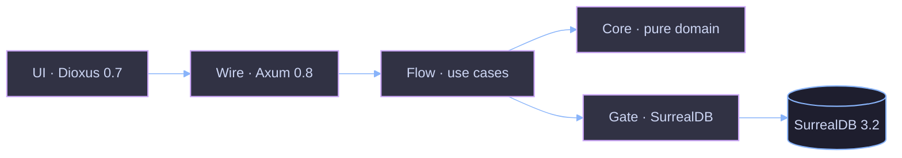

<!-- comment: Orbe — onboarding deck for new devs. ≤4 slides hard cap. EN -->

<!-- jump_to_middle -->

# Orbe

> **CRM for Colombian SMEs. Inventory-first. Grow from there.**
> MIT · MVP complete · Rust end-to-end.

<!-- new_line -->

`Dioxus 0.7 · Axum 0.8 · SurrealDB 3.2 · jj · no JS, no Node`

<!-- end_slide -->

---

# Stack & shape

<!-- column_layout: [2, 3] -->
<!-- column: 0 -->

### What runs where

| Layer    | Crate / path                          |
| -------- | ------------------------------------- |
| UI       | `Backend/Q/orbe-api/src/wire/ui/`     |
| Server   | `Backend/Q/orbe-api/src/wire/`        |
| HTTP     | `Backend/Q/orbe-api/src/wire/` (Axum) |
| Domain   | `Backend/Q/orbe-api/src/core/`        |
| Flow     | `Backend/Q/orbe-api/src/flow/`        |
| Persist  | `Backend/Q/orbe-api/src/gate/` (SurrealDB) |

<!-- column: 1 -->

### Clean arch



<!-- reset_layout -->

<!-- speaker_note: orbe-api is a single Rust crate. UI and server share the same binary via #[server] — one toolchain, one deploy. -->

<!-- end_slide -->

---

# Start in 60 seconds

```bash
+exec_replace:{cmd="just dev", lines=12}
```

### Read next

`SPEC.md` (132 lines) — what we're building and why
`CONVENTIONS.md` (129 lines) — how we name and structure things

<!-- speaker_note: just dev boots Dioxus on 8080 and connects SurrealDB on 8000. If something fails run just health and just logs. -->

<!-- end_slide -->

---

# Mood

Fast. Bold. Tactile.

Numbers animate from old to new when you change them — like WhatsApp
opening a chat, no flicker, no reload. The `$` amount is the hero on
every screen, the way it is on Nequi when you send money. Surfaces sit
on a deep black with a soft magenta glow, warm like Nu, never clinical.

One primary action per screen. Secondary actions reveal on demand. Every
tap is a tap you meant, never a navigation.

<!-- speaker_note: when in doubt, cut. If a screen needs two taps where one would do, it's wrong. The mood is the spec — feel it, then ship. -->

<!-- end_slide -->
