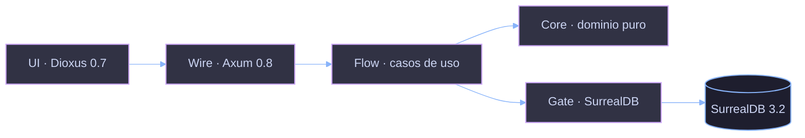

<!-- comment: Orbe — onboarding deck for new devs. ≤4 slides hard cap. ES -->

<!-- jump_to_middle -->

# Orbe

> **CRM para PYMEs colombianas. Inventario primero. Crece desde ahí.**
> MIT · MVP completo · Rust de extremo a extremo.

<!-- new_line -->

`Dioxus 0.7 · Axum 0.8 · SurrealDB 3.2 · jj · sin JS, sin Node`

<!-- end_slide -->

---

# Stack y forma

<!-- column_layout: [2, 3] -->
<!-- column: 0 -->

### Dónde corre qué

| Capa     | Crate / ruta                          |
| -------- | ------------------------------------- |
| UI       | `Backend/Q/orbe-api/src/wire/ui/`     |
| Server   | `Backend/Q/orbe-api/src/wire/`        |
| HTTP     | `Backend/Q/orbe-api/src/wire/` (Axum) |
| Dominio  | `Backend/Q/orbe-api/src/core/`        |
| Flujo    | `Backend/Q/orbe-api/src/flow/`        |
| Persist. | `Backend/Q/orbe-api/src/gate/` (SurrealDB) |

<!-- column: 1 -->

### Clean arch



<!-- reset_layout -->

<!-- speaker_note: orbe-api es un solo crate Rust. UI y servidor comparten binario vía #[server] — un toolchain, un deploy. -->

<!-- end_slide -->

---

# Arranca en 60 segundos

```bash
+exec_replace:{cmd="just dev", lines=12}
```

### Lee después

`SPEC.md` (132 líneas) — qué construimos y por qué
`CONVENTIONS.md` (129 líneas) — cómo nombramos y estructuramos

<!-- speaker_note: just dev arranca Dioxus en 8080 y conecta SurrealDB en 8000. Si algo falla corre just health y just logs. -->

<!-- end_slide -->

---

# Mood

Rápido. Audaz. Táctil.

Los números animan de viejo a nuevo cuando los cambias — como cuando
abres un chat en WhatsApp, sin parpadeo, sin recarga. El monto en `$` es
el héroe en cada pantalla, como en Nequi cuando envías plata. Las
superficies viven sobre negro profundo con un brillo magenta suave,
cálido como Nu, nunca clínico.

Una acción primaria por pantalla. Las acciones secundarias aparecen
bajo demanda. Cada toque es un toque que querías dar, nunca una
navegación.

<!-- speaker_note: cuando dudes, corta. Si una pantalla necesita dos toques donde uno basta, está mal. El mood es el spec — siéntelo y luego envía. -->

<!-- end_slide -->
