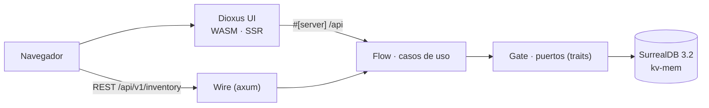

# Orbe

CRM de inventarios para pymes colombianas. Hoy: productos, stock y movimientos.
Después: clientes, ventas y **Orbe Cloud** (alojamiento gestionado, plan mensual).

| | |
|---|---|
| **Stack** | Rust 1.97 · Axum 0.8 · Dioxus 0.7 (WASM) · SurrealDB 3.2 · CSS con tokens · `just` · `jj` |
| **Puertos (local)** | web `:8080` · REST `:8080/api/v1/inventory` · RPC Dioxus `:8080/api` |
| **Estado** | inventario MVP (productos · stock · movimientos) · web + Android APK |
| **Rama de trabajo** | `develop` (`main` = release) |
| **Licencia** | AGPL-3.0-only · [modelo comercial](docs/legal/COMMERCIAL.md) |
| **Contexto completo** | [SPEC.md](SPEC.md) · [CONVENTIONS.md](CONVENTIONS.md) · [DESIGN.md](DESIGN.md) |

---

## Arquitectura



- Un solo crate (`crates/orbe-api`), Clean Architecture por dentro: `core → flow → gate → wire/ui`.
- Los `#[server]` son el **único** camino de la UI a los datos (SPEC V7); el REST usa los mismos casos de uso.
- El dinero es `i64` en centavos (V9). Las dependencias de SurrealDB se escriben con queries paramétricas (V8).
- Invariantes verificados en CI local: `just layer-check` (fronteras de capa), `just test` (V2–V5).

## Inicio rápido

```bash
just dev      # construye el bundle web y lo sirve en http://localhost:8080
just seed     # igual, con datos de ejemplo (database/seeds/inventory.toon)
just dev-release  # bundle de release (sin overlay de desarrollo)
just ci       # gate local: fmt · clippy · capas · tests · build · paridad de decks
just commit "msg"   # corre el gate y commitea con jj (no commitea en rojo)
```

Sin Docker ni Node: `cargo` + `dx` + `just` y nada más.

## Verificación

| Suite | Qué cubre | Comando |
|---|---|---|
| Dominio | invariantes V2/V3/V5 (sku único, slug único, stock ≥ 0) | `just test` |
| Flujo | oversell → error sin movimiento, 404s, stock a cero (fake port) | `just test` |
| Capas | V1/V7: nadie importa `gate/surreal` desde `wire/` o `ui/` | `just layer-check` |
| E2E | 18 checks REST + RPC contra un server que se levanta solo | `just smoke` |
| CI | todo lo anterior + fmt, clippy `-D warnings`, build | `just ci` · `just ci-full` |

CI **local y sin cuota**: `just ci` escribe `target/ci/report.json` (digest de inputs + resultado por check).
`just commit` refuses to commit if the gate is red or the tree changed mid-run.

## Estructura

```text
Orbe/
├── crates/orbe-api/     # el crate único: core, flow, gate, wire, ui + public/ (css, PWA)
├── database/            # schema/ (SurrealQL) · seeds/ (.toon)
├── config/Env.example
├── scripts/             # smoke · ci-report · commit · layer-check · br-sync · wasm-size
├── docs/                # decisions/ (ADRs) · decks/ · legal/ · archive/
├── Cargo.toml           # workspace + perfiles (target/ único)
└── justfile             # todos los comandos
```

## Documentación

| Recurso | Para qué |
|---|---|
| [`SPEC.md`](SPEC.md) | contrato: restricciones, invariantes, tareas, bugs |
| [`CONVENTIONS.md`](CONVENTIONS.md) | cómo se nombra, se capas y se prueba |
| [`DESIGN.md`](DESIGN.md) | sistema de diseño (tokens, motion, accesibilidad) |
| [`docs/legal/COMMERCIAL.md`](docs/legal/COMMERCIAL.md) | AGPL vs. Orbe Cloud, marca, licencias comerciales |
| [`docs/decks/`](docs/decks/README.md) | onboarding (presenterm) y PDF de cliente (typst) |
| [`docs/decisions/`](docs/decisions/) | ADRs: SurrealDB, capas, Dioxus fullstack |
| [`GUIDE.md`](GUIDE.md) | patrones de Rust/Dioxus que se usan aquí |

## Problemas frecuentes

- **La UI sale sin estilos o con rutas absolutas** → los assets se sirven desde la raíz (`/main.css`); `asset!()` en SSR mete la ruta del disco en el HTML. Nunca lo uses para CSS o manifest.
- **La UI se queda en "Cargando…"** → el SSR no encontró el bundle cliente. `just dev` lo construye y lo sirve; `cargo run` sólo da API + HTML.
- **"Your app is being rebuilt"** → overlay del cliente *debug*. `just dev-release` (o el bundle de release) sale limpio.
- **`target/` pesa 5.6 GB (13 GB con release)** → `just target-size` para el detalle, `just clean-ship` para borrar sólo los artefactos de envío.
- **El build de Android falla con "Unsupported class file major version 71"** → Gradle 9 no entiende el JDK 27; usa `JAVA_HOME=/usr/lib/jvm/java-17-openjdk`.
- **Los issues no aparecen en GitHub** → el tracker `br` es local; `just issues-sync` lo refleja al remoto.
- **El servidor suelta `NotFound` en un `DELETE`** → V5/V4 se validan en `flow`, no en la base.

## Licencia

**AGPL-3.0-only** ([LICENSE](LICENSE), [NOTICE](NOTICE)): instálalo, ejecútalo, autoalójalo, modifícalo.
Lo que vendemos es el **servicio alojado** (Orbe Cloud: hosting, backups, upgrades, onboarding, soporte),
no una licencia sobre el código. La marca "Orbe" está reservada.

> Si ofreces Orbe por red, AGPL §13 exige ofrecer a tus usuarios el código fuente de la versión
> que corres — un enlace "Código fuente" en la UI. Es un componente de una línea y es
> bloqueante antes del primer despliegue pago.

MIT → AGPL cambió a propósito: ver el razonamiento completo en
[`docs/legal/COMMERCIAL.md`](docs/legal/COMMERCIAL.md).
